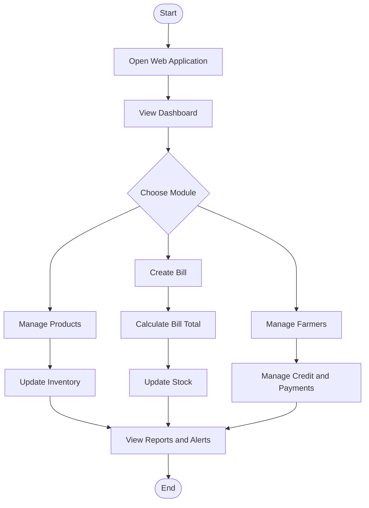

# 🌾 Agro Shop Billing and Stock Management System

<p align="center">
  <b>A Smart, Software-Based Solution for Agricultural Shop Management</b>
</p>

<p align="center">
  
  
  
  
</p>

## 📌 Project Overview

The **Agro Shop Billing and Stock Management System** is a web-based application designed to simplify the daily operations of agricultural shops. It helps manage agricultural products such as seeds, fertilizers, pesticides, and manures through a centralized software system.

The application aims to reduce manual work, improve stock tracking, simplify billing, maintain farmer credit records, and provide useful sales information.

## 🎯 Objectives

- 🌱 Maintain agricultural product details and inventory.
- 🧾 Generate bills and calculate purchase totals.
- 📦 Track stock quantities and low-stock products.
- ⏰ Monitor product batches and expiry dates.
- 👨‍🌾 Maintain farmer details and credit records.
- 💰 Track payments and outstanding balances.
- 📊 Display sales summaries and inventory reports.

## ✨ Key Features

| Feature | Description |
|---|---|
| 📊 Dashboard | View important shop information and summaries. |
| 🌱 Product Management | Add, search, view, and manage agricultural products. |
| 🧾 Billing System | Create bills and calculate item totals. |
| 📦 Stock Management | Update stock quantities after sales. |
| ⚠️ Stock Alerts | Identify products that need restocking. |
| ⏰ Expiry Tracking | Monitor batches and products approaching expiry. |
| 👨‍🌾 Farmer Management | Store farmer information. |
| 💳 Credit Management | Record credit sales, payments, and outstanding amounts. |
| 📈 Sales Reports | Review sales information and popular products. |
| 🖨️ Printable Bills | Print generated bills for shop records. |

*Note: Features should be marked as completed only after they have been implemented and tested in the application.*

## 🛠️ Technologies Used

| Technology | Purpose |
|---|---|
| 🐍 Python | Application logic and backend processing |
| 🌐 Flask | Web framework for routing and application handling |
| 🎨 HTML5 | Web page structure |
| 🖌️ CSS3 | Styling and responsive layouts |
| ⚡ JavaScript | Interactive user interface functionality |
| 🗄️ SQLite | Local database storage |
| 🧰 Git | Version control |
| 🐙 GitHub | Source code hosting and project collaboration |

## 🧠 Project Mind Map

```text
             🌾 AGRO SHOP MANAGEMENT
                       |
       +---------------+---------------+
       |               |               |
   📦 Inventory      🧾 Billing      👨‍🌾 Farmers
       |               |               |
   Product Details  Generate Bills   Credit Records
   Stock Tracking   Calculate Total  Payment Tracking
   Expiry Alerts    Reduce Stock     Balance Details
       |
       +---------------+---------------+
                       |
                📊 Reports & Dashboard
                       |
                Sales and Stock Summary
```

## 🔄 System Workflow



## 📂 Project Structure

```text
agro-shop-billing/
│
├── app.py                  # Flask application and backend logic
├── requirements.txt        # Required Python packages
├── README.md               # Project documentation
├── .gitignore              # Files excluded from Git
│
├── static/
│   └── style.css           # Website styling
│
└── templates/
    ├── base.html           # Common page layout
    ├── dashboard.html      # Dashboard
    ├── products.html       # Product management
    ├── farmers.html        # Farmer management
    ├── billing.html        # Billing interface
    ├── bill_detail.html    # Bill details
    ├── credit.html         # Credit management
    ├── alerts.html         # Stock and expiry alerts
    └── reports.html        # Sales reports
```

The SQLite database is generated locally by the application when it starts for the first time.

## 💻 Installation and Setup

### 1. Clone the Repository

```bash
git clone https://github.com/yokeshsk/agro-shop-billing.git
```

### 2. Open the Project Folder

```bash
cd agro-shop-billing
```

### 3. Create a Virtual Environment

```bash
py -m venv .venv
```

### 4. Activate the Environment

**Windows PowerShell:**

```powershell
.\.venv\Scripts\Activate.ps1
```

If PowerShell blocks activation, use Command Prompt instead:

```bat
.venv\Scripts\activate.bat
```

### 5. Install Dependencies

```bash
python -m pip install -r requirements.txt
```

### 6. Run the Application

```bash
python app.py
```

### 7. Open in Your Browser

Visit:

**http://127.0.0.1:5000**

Keep the terminal running while you use the application.

## 🧪 Testing Checklist

- [ ] Add and search for agricultural products.
- [ ] Verify product prices and available quantities.
- [ ] Generate a bill and check the total.
- [ ] Confirm stock is reduced after a sale.
- [ ] Test low-stock and expiry alerts.
- [ ] Register a farmer and record a credit sale.
- [ ] Record a payment and verify the remaining balance.
- [ ] Compare sales reports with recorded bills.
- [ ] Verify that data remains available after restarting the application.

## 🔮 Future Enhancements

- 🔐 User login and role-based access.
- 📱 Improved mobile-responsive interface.
- 📊 Interactive charts and advanced analytics.
- 🧾 Customizable invoice formats.
- 🔔 Automated stock and expiry notifications.
- 📤 Export reports to CSV or PDF.
- ☁️ Secure online deployment and database backup.

## 🎓 Project Applications

- Agricultural retail shops
- Seed and fertilizer stores
- Pesticide and manure dealers
- Small businesses that need basic inventory and billing software

## 👨‍💻 Developer

**YOKESH S K**

Computer Science and Engineering Student

GitHub: [@yokeshsk](https://github.com/yokeshsk)

## 📜 License

This project is developed for educational and academic purposes. A suitable open-source license can be added if you intend to distribute the project publicly.

## ⭐ Support

If you find this project useful, consider giving the repository a ⭐ on GitHub.

---

<p align="center">
  🌱 <b>Smart Inventory. Simple Billing. Better Shop Management.</b> 🌱
</p>
